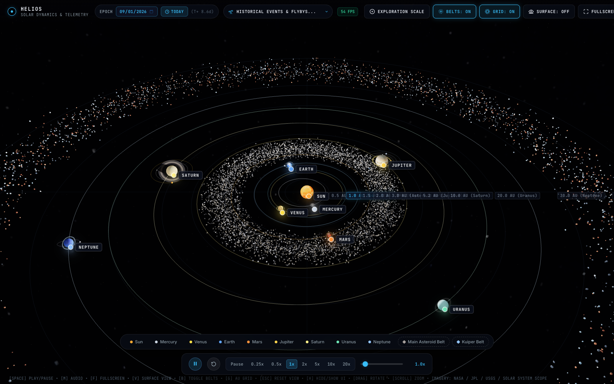
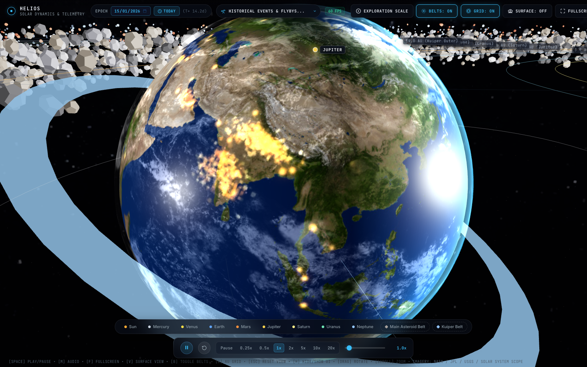
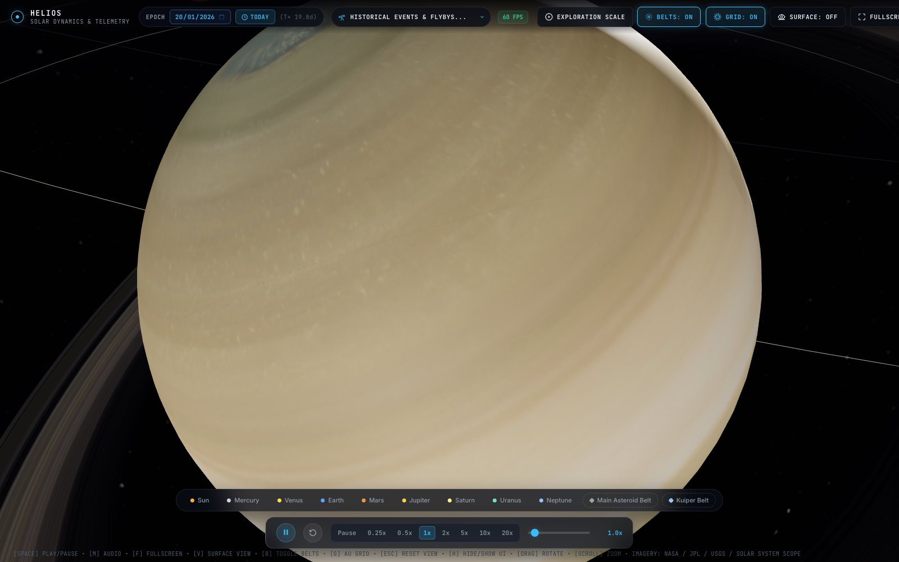
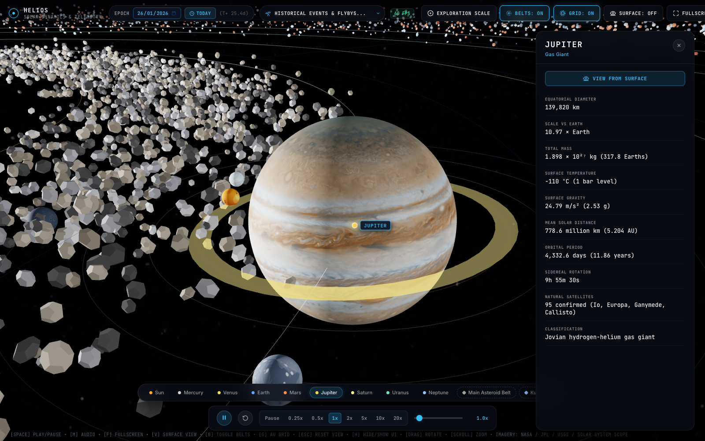
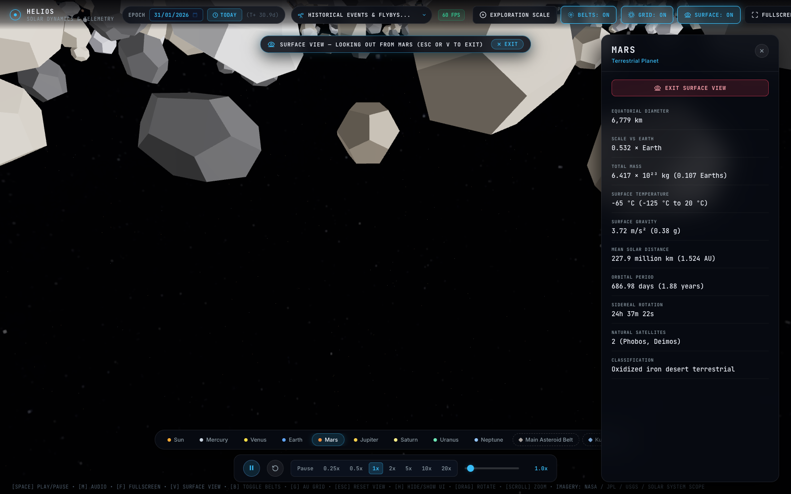

# Helios - 3D Solar System Simulation

Helios is an interactive 3D model of the solar system running directly in the browser. It combines Keplerian orbital mechanics with NASA imagery to show planetary orbits, sizes, and axial rotations.

Live site: https://stephenford.org/solar-system/


*Panoramic solar system overview displaying concentric Astronomical Unit (AU) distance circles, planetary orbit lines, and the 3D Main Asteroid Belt.*

---

## Visual Features & Highlights

### Earth Atmospheric Glow & Night-Side City Lights

NASA Blue Marble daytime imagery transitions seamlessly across the twilight terminator into a procedural NASA Black Marble night map with warm metropolitan city lights and a vibrant cyan-blue GLSL atmospheric Fresnel rim glow.

### Saturn Ring System & Solar Shadows

Analytical GLSL ray tracing projects an authentic curved shadow of Saturn's globe across its rings on the unlit side, while the rings cast subtle shadow bands across Saturn's cloud tops through gaps like the Cassini Division.

### Jupiter System & Observatory Telemetry

Jupiter surrounded by its four major Galilean moons (Io, Europa, Ganymede, and Callisto), with the telemetry drawer displaying live physical, compositional, and orbital data.

### Planetarium Surface Sky View

Surface Sky View mode places you directly on the ground of Mars, Earth, or any other world, tracking the planet's axial rotation to simulate realistic sunrises, sunsets, and celestial transits with optical telescopic zoom.

---

## Overview

The simulation models the Sun, the eight major planets, major natural satellites (Earth's Moon, the Galilean moons of Jupiter, Saturn's Titan and Enceladus, and Neptune's retrograde moon Triton), and realistic 3D instanced particle belts for both the Main Asteroid Belt (between Mars and Jupiter) and the Kuiper Belt (beyond Neptune). It runs entirely on client-side JavaScript using Three.js and vanilla ES modules, with no build tools, bundlers, or external package installations required.

### Key Capabilities

- Real Planetary Textures: High-resolution surface maps sourced from NASA, JPL, and USGS missions (SDO for the Sun, MESSENGER for Mercury, Blue Marble for Earth, Cassini for Jupiter and Saturn, and Voyager 2 for Uranus and Neptune).
- Planetarium Surface Sky View Mode: Place the camera directly onto the surface of Earth, Mars, the Moon, Titan, or any other world looking outward into the sky. Experience realistic day/night cycles with sunrises and sunsets, celestial planetary alignments, and moon transits with smooth optical field-of-view zoom.
- Curated Historical Events & Flybys: Built-in milestone navigator allowing one-click time jumps and camera tracking to landmark missions and alignments (Apollo 11 Moon Landing 1969, Voyager 2 Neptune Flyby 1989, Cassini Saturn Orbit Insertion 2004, Voyager 1 Interstellar Crossing 2012, New Horizons Pluto Encounter 2015, Great Conjunction of Jupiter & Saturn 2020, Mars Perseverance Landing 2021, and North American Total Solar Eclipse 2024) with full mission telemetry, scientific significance, and spacecraft details.
- 3D Asteroid & Kuiper Belts: Thousands of individual, irregular, low-poly rocky and icy planetesimals rendered in high-performance single draw calls using `THREE.InstancedMesh`. Each asteroid follows its own differential Keplerian orbit around the Sun ($\omega \propto r^{-3/2}$) with authentic carbonaceous, silicate, metallic, and volatile ice colorations.
- Astronomical Distance Grid (AU Circles): Concentric polar distance benchmark rings (0.5 AU, 1.0 AU Earth baseline, 1.5 AU, 2.0 AU, 3.0 AU, 5.2 AU Jupiter, 10.0 AU Saturn, 20.0 AU Uranus, 30.0 AU Neptune, 40.0 AU, and 50.0 AU) with dynamic scale interpolation and screen-space distance annotations in AU and millions/billions of kilometers.
- Two Scale Modes:
  - Exploration Scale: Radii and distances are balanced for interactive viewing so all planets and orbits can be inspected without getting lost in empty space.
  - True Scale: Shows true proportional distances and sizes, illustrating how vast and empty the solar system really is.
- Keplerian Orbital Mechanics: Planets and belt particles follow elliptical paths calculated from their semi-major axes, eccentricities, and orbital periods.
- Calibrated Planetary Rotation: Axial spin rates preserve each body's relative sidereal rotation period without spinning too fast to see surface features.
- Dynamic Epoch & Time Controls:
  - Jump to today's date with a single click.
  - Pick any specific date (past or future) to inspect planetary alignments.
  - Forward and reverse simulation time.
  - Linear speed adjustment from 0x (pause) to 20x.
- Procedural Celestial Audio & Plasma Synthesizer: 100% self-contained Web Audio API synthesizer generating deep-space cosmic background drones and authentic planetary plasma wave radio emissions (Jovian whistlers and magnetospheric chorus, Saturn Kilometric Radiation and ring dust hiss, solar acoustic oscillations, terrestrial auroral kilometric radiation, and thin Martian wind gusts) with automatic 3D proximity and focus crossfading.
- Smooth Navigation:
  - Exponential zoom scaling calibrated for both mouse wheels and Mac trackpads.
  - Click on any planet, asteroid belt, or locator marker to smoothly fly the camera into tracking orbit.
  - Telemetry drawer showing equatorial diameter, gravity, temperature, composition, and orbital period for each body.

---

## Controls

| Action | Input |
|---|---|
| Rotate View | Left click and drag |
| Pan Camera | Right click and drag |
| Zoom In / Out | Scroll wheel or two-finger trackpad swipe |
| Focus Planet / Belt | Click on a planet, label, or bottom bar chip |
| Reset Overview | Escape key or Reset View button |
| Toggle Fullscreen | F key or Fullscreen button |
| Toggle Cosmic Audio | M key or Audio button |
| Surface Sky View | V key or Surface View button / drawer action |
| Toggle Belts | B key or Belts button |
| Toggle AU Grid | G key or Grid button |
| Hide / Show UI | H key or Hide UI button |
| Play / Pause | Spacebar or Play/Pause button |
| Reverse Time | Reverse toggle button |

---

## Project Structure

- `index.html`: Main page layout, Three.js import map, and HUD overlay.
- `css/main.css`: Styling for the interface, HUD panels, and responsive layout.
- `js/engine.js`: Three.js scene setup, camera transitions, lighting, and animation loop.
- `js/audio.js`: Procedural Web Audio API synthesizer for cosmic drones and planetary plasma waves.
- `js/physics.js`: Keplerian orbit math, date conversions, and planetary positioning.
- `js/config.js`: Astronomical constants, orbital elements, physical dimensions, and telemetry stats.
- `js/ui.js`: DOM event handling, speed controls, telemetry drawer, and HUD updates.
- `js/textures.js`: Asset loader for photographic planet textures with a procedural fallback.
- `assets/textures/`: Planetary texture maps.

---

## Local Development

Because this project uses native browser ES modules, it runs directly from any local static file server:

```bash
python3 -m http.server 8000
```

Open `http://localhost:8000` in a browser to run the application.

---

## Data & Imagery Attribution

Planetary surface maps and photography are derived from public domain imagery published by NASA, the Jet Propulsion Laboratory (JPL), and the United States Geological Survey (USGS). Map projections and composite textures are distributed under CC-BY 4.0 by Solar System Scope.
